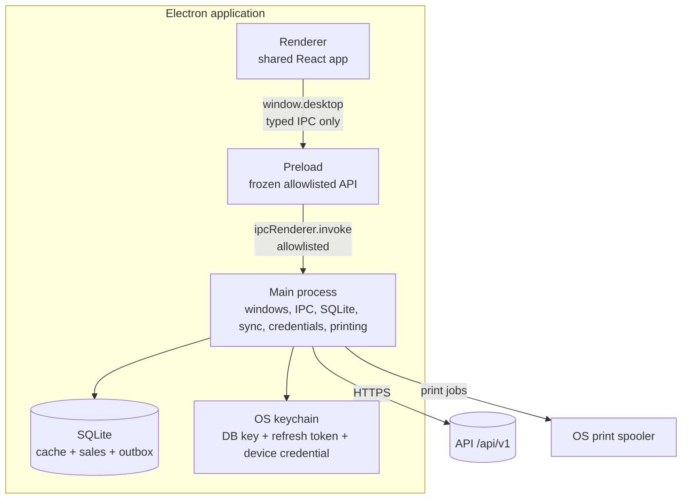

# Desktop architecture

**Status:** Step 2 design baseline. The Electron shell exists and is hardened at the main-process
level; SQLite, offline mode, printing and packaging do not exist. The renderer is the same web build
(implemented).

Decisions: D-009 (Electron), D-017 (SQLite), D-022 (outbox), D-029 (shared renderer). Offline
semantics are detailed in
[`../architecture/OFFLINE_SYNCHRONIZATION_ARCHITECTURE.md`](../architecture/OFFLINE_SYNCHRONIZATION_ARCHITECTURE.md).

## 1. Process model

The renderer has no Node.js, no filesystem, no database and no direct network privilege beyond normal
`fetch` to the API. The main process is the only component that touches SQLite, the keychain, the
printer and the sync queue.

## 2. Responsibilities

| Process  | Owns                                                                                                                                | Never does                                                             |
| -------- | ----------------------------------------------------------------------------------------------------------------------------------- | ---------------------------------------------------------------------- |
| Main     | Window lifecycle, security policy, IPC handlers, SQLite, local migrations, sync engine, credential storage, printing, update checks | Render UI, contain business rules that belong to the API               |
| Preload  | A frozen, typed bridge of allowlisted methods                                                                                       | Expose `ipcRenderer`, `require`, `fs`, `process` or raw channels       |
| Renderer | Screens, forms, local cart UI, offline status display, role-aware navigation                                                        | Open files, run SQL, hold the refresh token, bypass IPC for local data |

## 3. Security model

Implemented in the shell:

- `contextIsolation: true`, `sandbox: true`, `nodeIntegration: false`, `webSecurity: true`
  (`apps/desktop/electron/main/main.ts`).
- New windows denied; navigation restricted to `file:` or the trusted dev origin; webviews blocked
  (`apps/desktop/electron/main/security.ts`).
- All permission requests denied (`hardenSession`), to be opened only for explicitly supported
  hardware.
- Preload exposes one frozen object with allowlisted channels and an assertion before invoke
  (`apps/desktop/electron/preload/preload.ts`).

Design rules for everything added later:

1. Every IPC channel is named `domain:action` and listed in the shared contract. An unlisted channel
   is unreachable from the renderer.
2. `invoke`/`handle` only. No `send` to the renderer with untrusted payloads, no remote module.
3. The main process validates every payload with a schema, checks caller identity and applies limits
   before acting. Renderer input is untrusted even though the renderer is our code.
4. File access is by main-issued tokens or dialogs, never by a renderer-supplied absolute path.
5. No `eval`, no dynamic `require`, no remote content. The renderer loads the local build or the
   trusted dev server only.
6. Printing, serial and USB access stay in the main process. Device permissions are granted per
   device and per business, not globally.
7. Errors returned over IPC are normalized; stack traces and paths stay in main-process logs.
8. The API base URL is validated and can only be the configured origin.

## 4. Shared renderer and desktop detection

- Development: `WEB_DEV_URL` (default `http://localhost:5173`). Production: the built
  `apps/web/dist/index.html` (`renderer-target.ts`, covered by a unit test).
- There is no second React application. Desktop-only UI is rendered when `window.desktop` exists and
  the capability is present, for example `desktop.offline` or `desktop.print`.
- The web build must not crash when `window.desktop` is absent; all desktop calls go through a small
  adapter with a no-op or "unavailable" result.
- A feature never imports Electron types. The adapter owns the typed surface.

## 5. IPC contract

Current contract: `app:get-info` returning application, Electron, Chrome, Node and platform versions.

Planned channels (design, not implemented):

| Channel                    | Direction | Purpose                                                       | Validation / limit                                  |
| -------------------------- | --------- | ------------------------------------------------------------- | --------------------------------------------------- |
| `app:get-info`             | invoke    | Version information                                           | None                                                |
| `auth:login`               | invoke    | Authenticate; main stores refresh token                       | Rate-limited; credentials never logged              |
| `auth:get-access-token`    | invoke    | Return a valid short-lived access token, refreshing if needed | Single-flight; no refresh token returned            |
| `auth:logout`              | invoke    | Revoke session and clear local credentials                    | Clears vault entries                                |
| `device:enrol`             | invoke    | Bind this device to user, business, branch                    | Requires online session; Manager/Owner permission   |
| `device:status`            | invoke    | Enrolment, credential expiry, revocation state                | Read-only                                           |
| `offline:cache-status`     | invoke    | Feed age and last sync                                        | Read-only                                           |
| `offline:commit-sale`      | invoke    | Durable local sale + outbox write                             | Schema validated; single transaction; max cart size |
| `offline:list-sales`       | invoke    | Local sales with sync state                                   | Pagination, branch-scoped                           |
| `offline:list-outbox`      | invoke    | Pending/conflicted/rejected operations                        | Pagination                                          |
| `offline:sync-now`         | invoke    | Trigger a sync attempt                                        | Coalesced; no concurrent runs                       |
| `offline:resolve-conflict` | invoke    | Record a resolution action                                    | Role checked in main against cached context         |
| `offline:export`           | invoke    | Export local data for support                                 | Explicit user action; path chosen by dialog         |
| `print:receipt`            | invoke    | Print a locally rendered receipt                              | Template version pinned; no arbitrary HTML          |
| `files:pick-import`        | invoke    | Choose a CSV/XLSX file                                        | Dialog-owned path; size and type checked            |

Rules for contracts:

- Types are shared between preload, main and the renderer adapter in one module so a channel rename
  breaks compilation.
- The renderer cannot request arbitrary SQL, arbitrary file paths or arbitrary HTTP headers.
- Long-running operations report progress through a single subscribed event channel with a bounded
  payload, or the UI polls status. No unbounded streams.
- Every handler has a timeout and returns a typed error code, not an exception string.

## 6. Local database

- Location: the OS user-data directory, not the install directory.
- Engine: SQLite in WAL mode with foreign keys on, opened only by the main process.
- Encryption: file-level encryption with a key stored in the OS keychain. The key never appears in
  the renderer, logs or configuration files.
- Migrations: versioned, forward-only files shipped with the app. Before migrating, main takes a
  verified backup; a failed migration restores or blocks startup with an explicit message rather
  than running on a half-migrated schema.
- Conceptual contents: catalog/price/stock/config caches, local sales and lines, outbox, sync state,
  conflicts, local operators and permission snapshots, and sync history
  (see offline architecture §3).
- Integrity: `PRAGMA integrity_check` on startup; corruption blocks selling and offers an export.
- Retention: synced sales may be archived locally only after server acknowledgement and according to
  policy; nothing unsynced is ever pruned.

## 7. Authentication and operators offline

- The desktop refresh token lives in the OS keychain and is used only by the main process. The
  renderer gets short-lived access tokens through `auth:get-access-token`.
- A device is enrolled to one user, business and branch. Switching business on the same device
  requires re-enrolment and a feed reset; this keeps the offline cache unambiguous.
- To sell offline after a restart, the device supports local operator sign-in:
  - each operator who has signed in online on this device gets a locally stored PIN verifier
    (salted hash, never the PIN);
  - the cached permission snapshot is limited to POS-relevant permissions;
  - failed attempts are rate-limited and lock the terminal after a configured number of failures;
  - the offline session expires after a configured idle period, returning to the lock screen.
- Offline authority comes from the last synced snapshot, not from a token. The server re-validates
  membership, device and operation at sync time and can reject.
- A revoked device or operator cannot renew the device credential; existing local data is preserved
  and exportable.

## 8. Offline mode and sync

Triggers:

- app start, network regained, a completed sale, a periodic timer, and a manual "sync now";
- one sync at a time; queued triggers coalesce.

Behavior:

- When the API is unreachable, POS enters offline mode with a visible banner and the last feed age.
  Only the operations listed as offline in the offline architecture are enabled.
- The sale commits locally before the UI reports success; sync is a background concern (D-022).
- Conflict, rejection and failure results are stored locally and surfaced in a persistent queue.
  Nothing is auto-deleted.
- The renderer shows per-sale sync state and a business-level sync health view.

The full state machine, conflict taxonomy and recovery matrix are in
[`../architecture/OFFLINE_SYNCHRONIZATION_ARCHITECTURE.md`](../architecture/OFFLINE_SYNCHRONIZATION_ARCHITECTURE.md).

## 9. Printing and hardware

- Receipts are rendered from a shared template version cached with the configuration feed, then sent
  to the OS print spooler by main. The renderer never passes executable HTML to the printer.
- Online sales can also produce a server-rendered PDF for archive; the receipt number is identical.
- Barcode scanners that emulate a keyboard need no special permission. Serial/USB integrations, cash
  drawers and scales are future adapters in main, enabled per device and per business.
- Printer failure never reverses a sale. The UI offers retry and reprint.
- The current session handler denies all permission requests; hardware support must add explicit,
  narrow handlers, not a blanket allow.

## 10. Packaging and release

| Concern               | Requirement                                                                                      |
| --------------------- | ------------------------------------------------------------------------------------------------ |
| Build                 | Reproducible from a tagged commit in CI; the renderer build is the same artifact as web          |
| Signing               | OS code-signing certificate; keys in CI secrets, never in the repo                               |
| Installer             | Per-user install preferred; no admin rights unless a hardware driver requires it                 |
| Integrity             | Artifacts hashed and signed; the app refuses an unsigned update                                  |
| Targets               | Windows is the primary POS target; macOS/Linux are decided before packaging work, not assumed    |
| Tooling               | Packaging tool selected in the implementation plan; no tool is claimed here                      |
| Version compatibility | App declares a minimum supported API version; the API rejects clients below it with a clear code |

## 11. Updates

- The app checks a signed update feed at startup and periodically. Updates are staged and applied on
  restart.
- Staged rollout with a kill switch and rollback to the previous signed version.
- If an unsynced sale or pending outbox exists, the update is deferred or requires explicit user
  confirmation; the outbox and local database survive the update regardless.
- A failed update must leave the previous version runnable.
- Release notes state whether a local schema migration runs; migrations are backed up first.

## 12. Local security and privacy

- Encrypted database; key in keychain; no key backup to the cloud by the app.
- Local login lock, idle timeout, and per-operator attribution on every offline sale.
- Logs rotate locally and never include credentials, full customer PII or card data.
- Device revocation stops sync. Remote wipe is intentionally **not** automatic: the priority is not
  to destroy unsynced sales. A wipe requires an Owner/Manager action, offers an export first, and is
  audited when the device next connects.
- Stolen-device procedure: revoke device, revoke operator sessions, rotate credentials, retrieve the
  export if the device returns, reconcile unsynced sales from local history if possible.
- The renderer cannot read the database file even if a script is injected; the sandbox and IPC
  allowlist are the boundary.

## 13. Failure and recovery

| Failure                   | Behavior                                                                                |
| ------------------------- | --------------------------------------------------------------------------------------- |
| API unreachable           | Offline mode; POS continues; other writes disabled with explanation                     |
| Database locked           | Main serializes writes; the second write waits briefly then returns a typed retry error |
| Database corrupt          | Startup blocks selling, offers export, quarantines the file, requires re-enrolment      |
| Local migration fails     | Restore backup or stop with instructions; never run on a partial schema                 |
| Printer offline           | Sale completes; reprint available; no rollback                                          |
| Update fails              | Previous version remains runnable; feed can be rolled back                              |
| Keychain unavailable      | App runs read-only for cached data; no offline sale until resolved                      |
| Clock changed             | Sync uses stored timestamps; skew outside tolerance becomes a conflict                  |
| Device credential expired | Online refresh required; outbox preserved                                               |

## 14. Testing

| Area            | Test                                                                                       |
| --------------- | ------------------------------------------------------------------------------------------ |
| Renderer target | Unit tests for dev URL vs built file (implemented)                                         |
| Security policy | Navigation, window-open and webview denial; permission handler behavior                    |
| IPC             | Contract tests for each channel: valid, invalid, oversized, unauthorized payloads          |
| Local database  | Real SQLite integration for sale transaction, outbox persistence, migration, corruption    |
| Crash recovery  | Kill during commit, after commit before sync, during sync; assert no loss/duplication      |
| Offline sync    | Duplicate delivery, conflict, revoked device, feed gap (shared with API integration tests) |
| Printing        | Template version parity and failure isolation                                              |
| Packaging       | Clean install, upgrade with pending outbox, rollback, signature failure                    |
| Accessibility   | Keyboard-only POS flow; focus management in dialogs                                        |

Electron launch in this environment was not verified (binary download blocked); no desktop runtime
test is claimed until it runs.

## 15. Current state

| Piece                              | State                                 |
| ---------------------------------- | ------------------------------------- |
| Electron 45 shell                  | Implemented; launch unverified        |
| Window hardening                   | Implemented                           |
| Preload allowlist (`app:get-info`) | Implemented                           |
| Shared renderer loading            | Implemented (target selection tested) |
| SQLite, offline mode, sync         | Planned                               |
| Encrypted storage, keychain        | Planned                               |
| Device enrolment, offline login    | Planned                               |
| Printing and hardware              | Planned                               |
| Packaging, signing, updates        | Planned                               |
