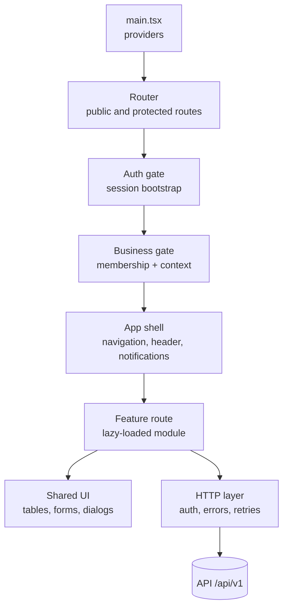

# Frontend architecture

**Status:** Step 2 design baseline. The implemented shell is one route (`/`) rendering the system
status page, plus a fetch helper. Everything else described here is planned.

Decisions: D-008 (React/Vite), D-020 (feature modules), D-029 (shared renderer). The desktop-specific
side is in [`../desktop/DESKTOP_ARCHITECTURE.md`](../desktop/DESKTOP_ARCHITECTURE.md).

## 1. Principles

1. **One renderer, two hosts.** The same React application runs in the browser and inside Electron.
   Desktop-only behaviour is capability-gated, never a forked screen.
2. **Features own their screens.** A business area is a folder with its routes, components, hooks,
   schemas and tests; it exposes a small public surface.
3. **The server is the authority.** The client never computes prices, stock, permissions or totals as
   truth. It renders what the API returns and asks for permission-shaped navigation only.
4. **Scope is in the URL.** Business and branch are route parameters, so a link is reproducible and a
   refresh never lands in an ambiguous tenant.
5. **Every async surface has four states:** loading, empty, error and ready. Offline adds a fifth:
   stale.

## 2. Application shape



## 3. Folder structure

```text
apps/web/src/
  main.tsx                 # React root, global styles
  app/
    App.tsx                # RouterProvider
    router.tsx             # route tree composition
    providers.tsx          # auth, query, theme, notifications (planned)
    error-boundary.tsx     # route-level error UI (planned)
    guards/                # auth/admin gates (planned)
  features/
    system-status/         # implemented
    auth/
      api/
      components/
      hooks/
      pages/
      schemas.ts
      routes.tsx
      public.ts            # optional cross-feature surface
      __tests__/
    businesses/
    dashboard/
    catalog/
    pricing/
    inventory/
    purchasing/
    pos/
    sales/
    after-sales/
    customers/
    employees/
    reports/
    intelligence/
    settings/
    subscriptions/
    platform-admin/
  shared/
    components/            # buttons, inputs, dialogs, tables, empty states
    layout/                # shell, sidebar, page header
    hooks/                 # useDebounce, useMediaQuery, usePermission
    permissions/           # navigation permission mapping
    formatting/            # money, quantity, dates
  lib/
    api-client.ts          # implemented probe client
    http.ts                # planned authenticated client
    problem-details.ts     # planned error parser
    env.ts                 # public config access
  styles/
    tokens.css             # design tokens (planned, extracted from global.css)
    global.css             # implemented
  test/
    setup.ts               # implemented
    render.tsx             # planned test helpers
```

Feature contract:

- A feature may import `shared/`, `lib/` and its own files. It may import another feature **only**
  through that feature's `public.ts`.
- A feature exports `routes.tsx` (lazy route objects) and optionally `public.ts`.
- A feature owns its API hooks and form schemas; it does not put business state in a global store.
- Tests live with the feature. A feature without tests is not complete, even if it renders.

Feature ownership follows the approved module allocation (D-034), because every module owner is also
responsible for its frontend slice:

| Member | Frontend feature areas                                                                                                                |
| ------ | ------------------------------------------------------------------------------------------------------------------------------------- |
| M1     | Auth, business switching, members/roles, employees, billing, platform support, audit                                                  |
| M2     | Onboarding/business configuration, catalog, pricing, shared design system and shell                                                   |
| M3     | Inventory, stocktake, transfers, suppliers, purchasing and receiving                                                                  |
| M4     | POS/shifts, customers, returns, sync status and reconciliation queues, dashboards and reports, advisory forecasts, notification inbox |

Shared `src/shared` frontend code is owned by M2; another member may contribute but M2 reviews.
Features owned by M4 that expose reconciliation UI must enforce nothing in the browser: the backend
permission and branch scope decide what is shown and what is accepted.

## 4. Entry points and routing

`main.tsx` mounts `App`, which renders `RouterProvider`. The route tree is composed from feature
route exports:

| Area            | Path                                                            | Access                        |
| --------------- | --------------------------------------------------------------- | ----------------------------- |
| Auth            | `/login`, `/register`, `/password-reset`, `/invitations/:token` | Public                        |
| Business picker | `/businesses`                                                   | Authenticated                 |
| Overview        | `/businesses/:businessId`                                       | Member                        |
| Catalog         | `/businesses/:businessId/products`, `/categories`               | Member, write per permission  |
| Pricing         | `/businesses/:businessId/prices`                                | Owner/Admin/Manager branch    |
| Inventory       | `/businesses/:businessId/branches/:branchId/inventory`          | Manager/Owner                 |
| Purchasing      | `/businesses/:businessId/purchasing/*`                          | Owner/Admin/Manager           |
| POS             | `/businesses/:businessId/branches/:branchId/pos`                | Cashier/Manager/Owner         |
| Sales           | `/businesses/:businessId/sales`, `/returns`                     | Role and branch scoped        |
| Customers       | `/businesses/:businessId/customers`                             | Cashier create/lookup, others |
| Reports         | `/businesses/:businessId/reports`                               | Role scoped                   |
| Intelligence    | `/businesses/:businessId/intelligence`                          | Manager/Owner, Admin view     |
| Settings        | `/businesses/:businessId/settings/*`                            | Owner/Admin                   |
| Billing         | `/businesses/:businessId/billing`                               | Owner; Admin invoice view     |
| Platform admin  | `/platform-admin/*`                                             | Super Admin with grant        |

Rules:

- Unknown paths render a 404 inside the current shell, not a blank screen.
- Each top-level area is lazy-loaded; the POS route is preloaded for cashier role.
- Route-level `errorElement` catches render and loader failures without taking down the shell.
- A permission-shaped route guard shows a "not available" page. It is UX, not security; the API
  enforces the real rule.
- Deep links must survive refresh. The router reads business/branch from the URL, never from memory.

## 5. Authentication state

- `AuthProvider` exposes `status` (`loading`, `anonymous`, `authenticated`), `user`, `signIn`,
  `signOut` and the current access token in memory.
- On load it attempts one refresh (web: httpOnly cookie; desktop: main-process vault via IPC). Success
  restores the session; failure lands on `/login` without a flash of protected content.
- `http.ts` attaches the access token, performs a single-flight refresh on `401`, retries once, and
  signs out on a second failure. Refresh loops are prevented.
- The refresh token is never persisted in `localStorage` or `sessionStorage` in the browser.
- Sign-out revokes the session server-side and clears cached query data.
- Password reset, invitation acceptance and email verification are public routes with their own
  minimal layout.

## 6. Business and branch selection

- After sign-in, the client loads `GET /api/v1/me/businesses`. One business: navigate directly.
  Several: show the picker.
- Choosing a business navigates to `/businesses/:businessId`; a layout route loads
  `GET /businesses/:businessId/context` (role, branches, permissions, capabilities).
- Branch selection is part of the URL (`/branches/:branchId/...`). If the user has one branch it is
  selected automatically; several branches show a selector in the header.
- The last-used business/branch per user is a local convenience only. It is validated against the
  context before use.
- Switching business clears server-state caches scoped to the previous business and resets the
  branch selection. It does not require a new login in the browser. A desktop POS device is bound to
  one business and branch; switching there requires re-enrolment, as described in the desktop
  architecture.
- A revoked membership drops the user back to the picker on the next failing request, with a clear
  message.

## 7. Role-aware navigation

Navigation is generated from the business context plus a static route-permission map:

| Role           | Default navigation                                                                              |
| -------------- | ----------------------------------------------------------------------------------------------- |
| Owner          | Everything, including billing, settings, audit, all branches                                    |
| Business Admin | Settings, catalog, pricing, suppliers, users, reports, audit; **no POS or inventory execution** |
| Manager        | POS, sales, returns, inventory, purchasing, assigned-branch reports, customers                  |
| Cashier        | POS, own sales, own shift, customer lookup; no catalog editing or reports                       |

- The map is data, not scattered conditionals. A route absent from the user's permissions is not
  rendered.
- Direct access to a hidden route renders a 403-shaped page with a link back, not a redirect loop.
- Actions inside a screen (approve, refund, adjust) are also permission-gated in the UI, but the
  server remains the deciding authority.
- The UI must never grant a physical operation to Business Admin because the permission is missing
  from that role's catalogue (D-027).

## 8. Server state and local state

| State kind          | Mechanism                                                     | Examples                                      |
| ------------------- | ------------------------------------------------------------- | --------------------------------------------- |
| Server state        | TanStack Query (planned dependency) with business-scoped keys | Products, stock, orders, reports              |
| URL state           | Router params and search params                               | Business, branch, filters, page, selected tab |
| Session state       | `AuthProvider` context                                        | User, token, sign-in status                   |
| Business context    | `BusinessProvider` context                                    | Role, permissions, branches, capabilities     |
| Form state          | React Hook Form + Zod schema per feature (planned)            | Product form, receiving form                  |
| Local UI state      | Component state, reducers                                     | Dialogs, POS cart, wizard step                |
| Durable local state | Desktop main process via IPC (POS cart draft, outbox)         | Offline sale, queued shift                    |

- No Redux-style global store. If two distant features need the same data, it is either server state
  (query) or context owned by the shell.
- Query keys always include `businessId` and `branchId` where applicable, so switching scope cannot
  serve another tenant's cached data.
- Mutations invalidate the smallest useful key set; optimistic updates are used only where rollback
  is safe (for example, toggling a filter), never for stock, money or receiving.
- The POS cart is local and durable: on desktop it is persisted through IPC so a crash does not lose a
  cart. It is not server state until the sale completes.

## 9. API communication

- `lib/http.ts` wraps `fetch` with: base URL from `VITE_API_URL` (dev proxy handles `/api`), bearer
  token, JSON handling, `AbortSignal`, timeout, correlation ID capture and problem-details parsing.
- `401` triggers one refresh; `403` shows a permission message; `404` on a business resource shows
  "not found or no access"; `409` surfaces conflict UI; `422` maps field and business errors; `429`
  shows retry-after; `5xx` shows a retry panel with the correlation ID.
- GET requests may retry once on network failure. Mutations retry **only** when they carry an
  idempotency key or an operation ID; the user-visible retry button is otherwise the mechanism.
- The client sends `Idempotency-Key` for sale, receiving, refund, adjustment and checkout creation.
- The current `api-client.ts` is probe-only and returns bodies for any status. The authenticated
  client is a separate module; probes keep their simple behavior.
- Desktop offline path: POS calls a gateway that uses the API when online and the main process's
  local sale command when offline. The renderer never talks to SQLite directly.

## 10. Forms

- Each feature defines a Zod schema for client validation; server DTO validation remains
  authoritative.
- React Hook Form handles field state and submission; server field errors are mapped back to inputs.
- Money and quantity inputs use dedicated components that emit integer minor units and decimal
  strings respectively, never floats.
- Destructive or money-moving forms require explicit confirmation and, where applicable, step-up
  re-authentication.
- Submit buttons are disabled only while a request is in flight, never based on a guessed validity
  that hides server errors. Unsaved-change warnings protect long forms.

## 11. Loading, empty, error and offline states

| State         | Pattern                                                                                       |
| ------------- | --------------------------------------------------------------------------------------------- |
| Loading       | Skeletons for lists/cards; inline spinner for actions; no full-page spinner on refetch        |
| Empty         | Purpose-built empty state with the next action (create product, receive stock)                |
| Error         | Inline error panel with retry; route-level boundary for render failures; correlation ID shown |
| Partial error | The page renders what succeeded and marks failed sections                                     |
| Offline       | Persistent banner; POS switches to offline mode; other writes disabled with explanation       |
| Stale         | Cached data shows `asOf`; stock and price surfaces mark staleness                             |
| Forbidden     | Clear permission message, not a silent redirect                                               |

No component should render `null` for a failed fetch without an explanation.

## 12. Notifications

- **In-app toasts** for transient results (saved, approved, copied).
- **Notification center** for persistent items: sync conflicts, failed deliveries, subscription
  issues, low-stock alerts from the backend.
- **Server-side** email/SMS for verification, invitations, subscription and conflict alerts.
- Toasts never carry sensitive data and never replace an audit trail.
- Conflict and failure notifications remain until dismissed or resolved; success toasts auto-dismiss.

## 13. Responsive design

- Mobile-first CSS with breakpoints at 640, 1024 and 1280 px using design tokens.
- Admin tables collapse into summary cards on narrow screens; filters become a sheet.
- POS targets tablet and desktop: large touch targets, barcode-first input, keyboard shortcuts, and a
  printable receipt layout. The Electron window minimum is 1024×700.
- The web app must remain usable at 360 px for owners checking reports on a phone.
- Print styles hide navigation and render receipts/reports at the correct page size.
- No hover-only affordances; focus and touch states are explicit.

## 14. Business-type adaptation

The renderer reads `businessType`, `capabilities` and `labels` from the business context. One codebase
renders all four types; differences are configuration, not forks.

| Business type | UI adaptations                                                                                       |
| ------------- | ---------------------------------------------------------------------------------------------------- |
| Grocery       | Weight/unit emphasis, fast barcode scan, simple variant set, optional expiry, shelf/location fields  |
| Fashion       | Size/color variant matrix, season/collection fields, barcode per variant, no batch/expiry by default |
| Pharmacy      | Mandatory batch and expiry, prescription reference, strict pack units, recall/quarantine actions     |
| Cosmetics     | Shade variants, kit/bundle composition, optional batch/expiry, shelf-life warnings where configured  |

Implementation rules:

- Capability flags drive field visibility and validation hints (`inventory.batch`,
  `catalog.variant-matrix`, `catalog.weight-units`). A capability off means the field is absent, not
  merely hidden by CSS.
- Labels come from the configuration registry (`labels.product`, `labels.batch`), with safe defaults.
- Business branding (accent color, logo) is a token override per business; structural layout stays
  shared.
- A new business type must be addable by configuration plus a profile test, without editing feature
  folders.

## 15. Accessibility

Target: WCAG 2.1 AA.

- Semantic landmarks, one `h1` per page, labelled inputs, visible focus, skip link.
- Color contrast checked for both light and dark tokens; status is never conveyed by color alone.
- Keyboard: full tab order, Escape closes dialogs, focus returns to the trigger, POS shortcuts
  documented.
- Screen-reader announcements for cart total changes, validation summaries, sync conflicts and toast
  messages (`aria-live`).
- Dialogs trap focus and use `aria-modal`; tables use proper headers and captions.
- Reduced-motion preference disables non-essential animation.
- Automated checks (axe) run in component tests; manual keyboard and screen-reader checks are part of
  the release checklist.

## 16. Testing

| Layer         | Tooling                                  | Coverage                                                          |
| ------------- | ---------------------------------------- | ----------------------------------------------------------------- |
| Unit          | Vitest                                   | Formatters, permission mapping, reducers, problem-details parsing |
| Component     | Vitest + Testing Library                 | Forms, tables, guards, empty/error states, role-aware navigation  |
| Route         | Testing Library with `MemoryRouter`      | Auth gate, business gate, deep links, 403/404                     |
| API mocking   | MSW (planned)                            | Deterministic success, error, 401, 409 and offline scenarios      |
| Accessibility | axe-core integration (planned)           | No serious violations on key screens                              |
| End-to-end    | Playwright (planned)                     | Login, product creation, sale, receiving, refund, offline sync    |
| Desktop       | Vitest for renderer + main-process tests | IPC contracts, offline gateway, crash recovery                    |

Rules:

- Tests assert user-visible behavior, not implementation details or snapshots alone.
- Every permission-sensitive screen has a test proving a disallowed role cannot see or trigger the
  action (and that the API call is not made).
- No test claims browser or Electron verification that did not run. A skipped suite is reported as
  skipped.

## 17. Current state

| Piece                             | State                               |
| --------------------------------- | ----------------------------------- |
| React/Vite shell, router          | Implemented (one route)             |
| System status feature             | Implemented                         |
| Probe API client                  | Implemented                         |
| Auth provider and guards          | Planned                             |
| Business context and picker       | Planned                             |
| Feature modules                   | Planned                             |
| Authenticated HTTP client         | Planned                             |
| TanStack Query, forms, MSW        | Planned; dependencies not installed |
| Playwright and axe suites         | Planned                             |
| Business-type capability registry | Planned (API side first)            |
